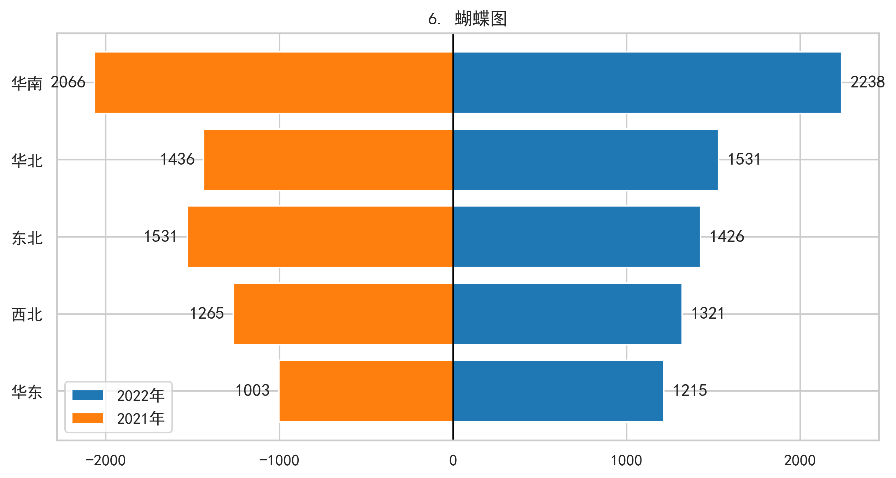

# 📊 可视化与商业数据分析（Project_A就是可视化作业！！！）

欢迎来到我的数据分析作品集仓库！本项目包含两个独立的数据分析实战作业，分别侧重于**数据可视化技术**与**商业分析框架**的应用。

---

## 📁 包含项目

### 📈 项目一：大数据与可视化
> **核心内容**：基于 Python 技术栈，使用真实的 Excel 零售业务数据，完成数据清洗、处理以及 30 张经典可视化图表的复现。
> 
> **技术栈**：Pandas, Matplotlib, Seaborn
> 
> 👉 **[点击此处查看《大数据与可视化》详细说明及代码](Project_A/README.md)**

*(效果预览)*
| 渐变柱形图 | 蝴蝶图 |
| :---: | :---: |
|  |  |


### 💼 项目二：商业数据分析
> **核心内容**：基于真实的商业案例数据，涵盖多个章节的数据分析框架与业务应用（如用户画像、效应分解预测、业务看板等）。
> 
> **技术栈**：Python, Pandas, 数据可视化
> 
> 👉 **[点击此处查看《商业数据分析》详细说明及图表](<商业数据分析/README.md>)**

*(效果预览)*
| 网站访问流向桑基图 | 航空客流效应分解 |
| :---: | :---: |
|  |  |

---

## 💻 快速开始

如果您想在本地运行这些代码，请按照以下步骤操作：

1. **克隆仓库到本地**
   ```bash
   git clone https://github.com/hillck12-jpg/你的仓库名.git
