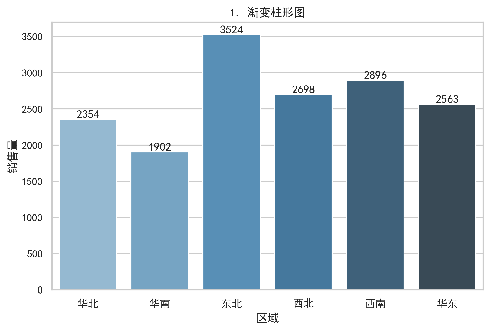

# 零售数据图表复现与可视化分析
Retail Data Visualization & Business Analysis

## 项目简介
本项目基于 Python 技术栈，使用真实的 Excel 零售业务数据，完成数据清洗、处理以及经典可视化图表的复现。旨在通过代码将静态数据转化为直观的商业图表，为商业数据分析提供可复用的技术方案与决策参考。

## 项目结构
- **`data/`**：存放原始 Excel 数据文件
- **`scripts/`**：核心代码脚本（包含数据清洗与可视化绘图）
- **`figures/`**：可视化输出图表（PNG 格式）
- **`requirements.txt`**：依赖包清单
- **`README.md`**：项目说明文档

## 核心功能
1. **数据清洗**：使用 Pandas 库读取 Excel 数据，处理缺失值与异常值，提取核心业务字段。
2. **图表复现**：基于 Matplotlib/Seaborn 构建静态图表，涵盖销售额趋势、品类分布、客户画像等核心维度。
3. **结果输出**：图表一键生成并自动保存为高分辨率 PNG 图片，方便直接嵌入报告或 PPT 中。

## 环境配置
- **依赖包安装**：`pip install -r requirements.txt`
- **环境要求**：Python 3.8+，支持 Windows/macOS/Linux。

## 快速使用
1. 将你的 Excel 数据文件放入 `data/` 目录下。
2. 在终端进入 `scripts` 目录并运行：`python visualization_basic.py`
3. 运行后，图表将自动保存至 `figures/` 目录。

```bash
cd scripts
python visualization_basic.py
## 效果预览

| 渐变柱形图 | 蝴蝶图 |
| :---: | :---: |
|  |  |
